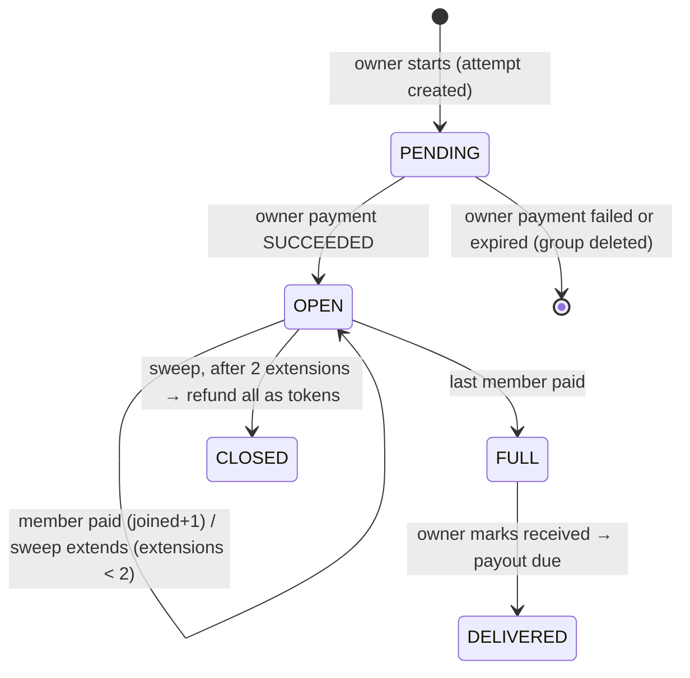

# Family Packs: architecture spine

**Paradigm.** The app is a modular monolith in Next.js 16 and Prisma 7 on Postgres. The domain lives in `src/server/packs*.ts` as plain transactional services. Pages and actions only call services. State changes happen inside `db.$transaction`, under a row lock on the group.

## Decisions

**AD-1. A spot is a paid PackMember** `[ADOPTED]`
- **Binds:** join, start, notice.
- **Rule:**
  - A join creates a `PackMember` with status `HELD` and a `PaymentAttempt` with purpose `PACK_JOIN` and `packMemberId`.
  - The group's `joined` counts HELD and PAID members, so a hold reserves a spot.
  - A hold expires on the attempt's `expiresAt` (15 min). Expiry deletes the member and decrements `joined`.
  - A verified SUCCEEDED notice sets the member to PAID.
- **Prevents:** overfilling while a payment is pending, and charging without a spot.

**AD-2. Lock order**
- **Rule:** lock the `PackGroup` row (`FOR UPDATE`), then the PackMember and attempt rows, then the ledger `User` rows. The notice handler and sweep take the same order.
- **Prevents:** deadlocks between a notice, a join and the sweep.

**AD-3. Owner opens the group**
- **Rule:**
  - `startGroup` creates the group as `PENDING` with `ownerId`, plus the owner's held spot.
  - When the owner's attempt SUCCEEDS, the group becomes `OPEN`.
  - If it fails or expires, the group and its spot are deleted.
  - Only `OPEN` groups are listed or joinable.
- **Prevents:** groups that no one has paid for.

**AD-4. Location snapshot**
- **Rule:**
  - `PackGroup` copies the owner's `lat`, `lng`, `address` and `city` when it is created.
  - Groups near you means `distanceKm(buyer, group) ≤ 1` (`src/lib/distance.ts`), filtered in SQL with a bounding box and then exactly in JS.
  - Agents are not used.
- **Prevents:** a group moving when the owner later edits their address.

**AD-5. Versions are immutable**
- **Rule:**
  - A `PackVersion` with `publishedAt` set is never updated.
  - The price, `commissionPct`, `groupSize` and items are read from the version a group points at.
  - Every money figure is calculated from that version.
- **Prevents:** a price or contents change for families who already joined.

**AD-6. Sweep step `packGroups`**
- **Rule:** added to `runSweep`. For each OPEN group past `closesAt`:
  1. If `extensions < 2`, push `closesAt` out by `durationDays` and increment `extensions`.
  2. Otherwise set the group to CLOSED. Each PAID member gets one `post()` of kind `PACK_REFUND` for the full price, with the idempotency key `pack-refund:<memberId>`, so running it twice pays once.
  3. Expired holds are released in the same step.
- **Prevents:** double refunds and refunds paid outside the cron.

**AD-7. Fulfilment is its own record**
- **Rule:**
  - When a group becomes FULL, it creates a `PackDelivery` (groupId unique, status `ORDERED → DISPATCHED → RECEIVED`) addressed to the owner's snapshot.
  - It does not reuse `Order` or `Basket`, which are built around variants and agents.
  - The company's seller account (`Company.sellerId`) sees its deliveries.
- **Prevents:** pack flows leaking into old checkout invariants.

**AD-8. Money**
- **Rule:**
  - All amounts are `Decimal(14,2)` and use `D` and `roundMoney`.
  - Commission per member is `roundMoney(price × commissionPct / 100)`.
  - When the delivery is RECEIVED, the company is owed `(price − commission) × members`, added to the existing weekly `FactoryPayout` as a pack line.
- **Prevents:** float money, and a payout before goods arrive.

**AD-9. Privacy**
- **Rule:**
  - Before FULL, the services return only counts, distance, city and the closing date.
  - After FULL, members get the owner's first name, phone and address, and the owner gets the members' first names and phones. Only members of that group are served this.
- **Prevents:** contact details leaking to strangers.

## Seed (owned by the code once it is built)
The schema delta on the MVP is:
- remove `PackGroup.agentId` and `User.pickupAgentId`;
- `PackGroup`: add `ownerId`, `lat`, `lng`, `address`, `city`, `extensions Int @default(0)`, and status `PENDING`;
- `PackMember`: add `status HELD|PAID`;
- `PaymentAttempt`: add `packMemberId String? @unique`;
- add the enum values `PaymentPurpose.PACK_JOIN` and `TokenKind.PACK_REFUND`;
- `PackVersion`: add `commissionPct Decimal(5,2)`;
- `Company`: add `sellerId`;
- add a new `PackDelivery`.

## Deferred
- Admin screens for companies, packs and versions. The seed only for now.
- Redelivery cost when the owner can't be reached (PRD open question 1).
- Who sets the closing period (PRD open question 2). The default is the pack's `durationDays`.
- Retiring the agent screens. The system is not yet published, so this can be a separate cleanup.
- Deployment is unchanged: the same app, database and cron.
