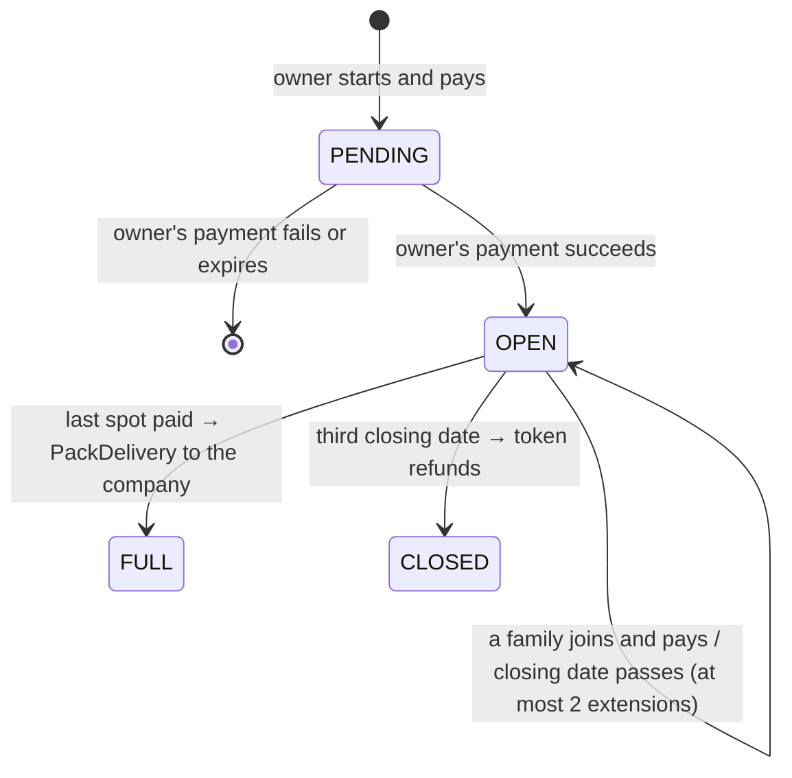

# Architecture

One Next.js 16 app (server-rendered pages, server actions and two API routes) on one PostgreSQL
database through Prisma 7. There are no workers, queues or caches: one daily cron call runs
the time-based rules.

## Basket life

## Code map

| Area | Files |
| --- | --- |
| Pages | `src/app/page.tsx` (home), `companies/[slug]`, `packs/[slug]`, `baskets` (open baskets), `baskets/[id]`, `baskets/return/[attemptId]`, `tokens`, `account`, `(auth)/sign-in`, `(auth)/sign-up`, `demo-pay/[attemptId]`, `company` (company dashboard), `img/[id]` (uploaded images) |
| API | `api/payments/notify` (gateway notices), `api/cron/sweep` (daily job) |
| Reading packs and baskets | `src/server/packs.ts`: home companies, company, pack, open baskets within 1 km, one basket |
| Joining and paying | `src/server/packs-join.ts`: start, join, confirm a paid spot, release an unpaid one, fill |
| Company dashboard | `src/server/company.ts` and `company-actions.ts`: banner, logo and pack photos (stored in the `Image` table), new pack versions, orders. `npm run company:login -- <email> <slug>` gives a login a company |
| Daily job | `src/server/packs-sweep.ts`: expire unpaid spots, extend or close due baskets |
| Payments | `src/server/payments/`: gateway interface, demo gateway, verified notices |
| Tokens | `src/server/tokens.ts`: balance and idempotent credits |
| Sign-in | `src/server/auth/`: sign-up, profile, password lockout, sessions |
| Pure rules | `src/lib/`: money (`decimal`, `pack-money`), distance, map pin, formatting |
| Data | `prisma/schema.prisma`, one migration, `prisma/seed.ts` (demo data) |

## Concurrency

Lock order is always the `PaymentAttempt` row, then the `PackGroup` row. A held spot counts in
`joined`, so the last spot goes to exactly one family. Each gateway event is applied once
(`PaymentEvent` unique on gateway and event id), and each token credit once (`eventKey`). The
gateway is never called inside a transaction.

## Built

Everything in the code map is built and tested. `tests/integration/` covers joins, races,
payments, the sweep, tokens and the seed, and `tests/e2e/` covers the browser journey,
accessibility, security headers, theme and the error page, and the company dashboard.

## Not built yet

See the open questions in [decisions](decisions.md). PayHere itself is not connected: only the
demo gateway runs, behind the same interface.
